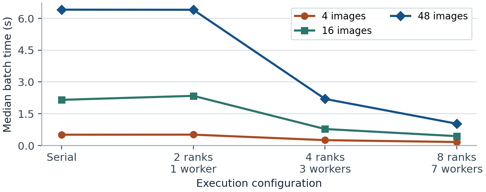
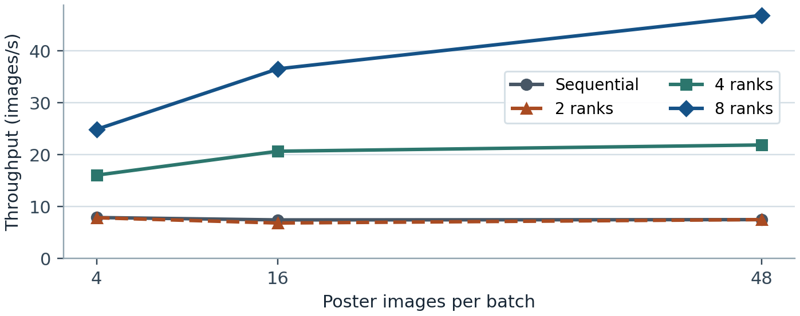

# PixelDispatch

CSC447 Project 08 distributes complete poster-processing jobs using the C API from Open MPI. The sequential and distributed executables run the same C17 resize, brightness, and box-blur pipeline and produce one RGB PNG per job.

This repository contains the source, build files, benchmark tools, and measured results. The complete setup and reproduction commands are in [README.txt](README.txt).

## Quick check on Linux or WSL2

```bash
sudo apt install build-essential openmpi-bin libopenmpi-dev libpng-dev python3-pil
make -j
demo=$(mktemp -d)
python3 tools/prepare.py "$demo/input" --sizes 4
./build/sequential "$demo/input/batch-4.txt" "$demo/seq" 161 103 18
mpirun --map-by slot --bind-to none -np 4 ./build/distributed "$demo/input/batch-4.txt" "$demo/mpi4" 161 103 18
python3 tools/verify.py "$demo/seq" "$demo/mpi4" 4 161 103
```

Rank 0 sends jobs and collects results. The other ranks read shared input files, process one image at a time, and save to a shared output directory. Four total ranks give three image workers. Each return carries a job ID and status, and rank 0 checks both before assigning more work.

## Results

On one Intel Core i7-12700 PC with WSL2 and Open MPI 5.0.10, the 48-poster median fell from **6.410 s to 1.025 s (6.25×)** with 8 total ranks and 7 image workers. Throughput rose from 7.5 to 46.8 images/s. All MPI output matched the sequential baseline. The local Creative Space Studio also verified eight supplied samples and three posters at zero tolerance.





See [median times and throughput](results/summary.csv), [individual runs](results/runs.csv), [jobs and busy time by rank](results/per_rank.csv), and [correctness evidence](results/correctness.txt).
